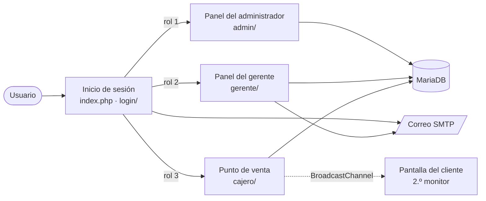
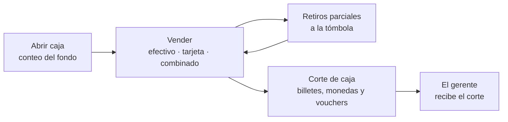
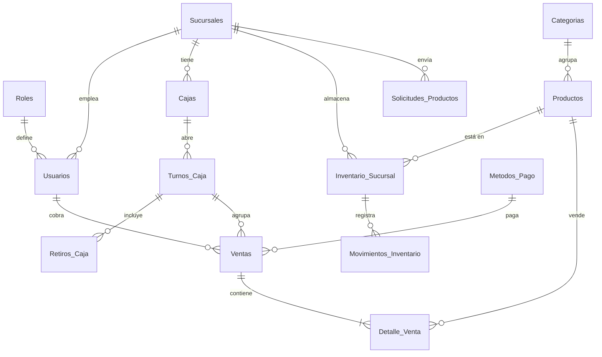

<div align="center">


# Koaly

**Punto de venta e inventario para empresas con varias sucursales.**

Administración central de sucursales y personal, inventario propio en cada tienda<br>
y una caja pensada para el día a día de una tienda de conveniencia.

[**Ver sitio en vivo**](https://koalicius.com/) · [Recorrido](#-recorrido-por-la-plataforma) · [Cómo usar](#-cómo-usar-koaly) · [Equipo](#-equipo)

<br>


</div>

<br>

<!-- 📸 PORTADA · docs/capturas/portada.png
     Opción recomendada: un montaje de 3 pantallas (Panel general del admin, Punto de venta y
     Pantalla del cliente) sobre fondo morado #7c3aed, a 1600×900 (Canva o Figma).
     Opción rápida: una copia de 04-admin-panel.png con el nombre portada.png. -->
<p align="center">
  
</p>

---

## 📑 Contenido

- [Acerca de Koaly](#-acerca-de-koaly)
- [Características principales](#-características-principales)
- [Roles y permisos](#-roles-y-permisos)
- [Cómo usar Koaly](#-cómo-usar-koaly)
- [Recorrido por la plataforma](#-recorrido-por-la-plataforma)
- [Tecnologías](#-tecnologías)
- [Arquitectura](#-arquitectura)
- [Estructura del proyecto](#-estructura-del-proyecto)
- [Base de datos](#-base-de-datos)
- [Seguridad y privacidad](#-seguridad-y-privacidad)
- [Idiomas](#-idiomas)
- [Próximas mejoras](#-próximas-mejoras)
- [Equipo](#-equipo)
- [Licencia](#-licencia)

---

## 📖 Acerca de Koaly

Muchas cadenas pequeñas llevan las ventas y el inventario de cada tienda por separado, en libretas u hojas de cálculo. Así es difícil saber cuánto se vendió en toda la empresa, qué productos se están agotando o si el efectivo de una caja cuadra al final del turno.

**Koaly** reúne todo en una sola plataforma web con tres tipos de usuario:

| Rol | Qué hace en Koaly |
| :-- | :-- |
| **Administrador** | Da de alta sucursales y gerentes, aprueba los productos del catálogo y ve las ventas y reportes de toda la empresa. |
| **Gerente** | Administra su sucursal: inventario, precios y costos, cajeros, cajas, cortes de caja, ventas y gráficas. |
| **Cajero** | Vende desde el punto de venta, cobra en efectivo, con tarjeta o combinado, y abre, arquea y cierra su caja. |

Cada venta descuenta el inventario de la sucursal en el momento, queda ligada al cajero, la caja y el turno, y aparece de inmediato en los paneles del gerente y del administrador.

> [!NOTE]
> Koaly es el Proyecto Integrador del equipo 4 de 3.<sup>er</sup> semestre, grupo D, de la carrera de Ingeniería en Software en la Facultad de Ingeniería Electromecánica (FIE) de la Universidad de Colima.

---

## ✨ Características principales

### Punto de venta
- Catálogo por categorías con imagen y existencias a la vista ("Quedan 3", "Agotado").
- Buscador por nombre o clave, compatible con lector de código de barras.
- Cobro en efectivo con cálculo de cambio, con tarjeta o combinado, con el IVA desglosado.
- Revisión de existencias antes de cobrar y descuento automático del inventario al confirmar la venta.
- Tickets imprimibles de venta, arqueo, retiro parcial y corte.
- **Pantalla del cliente** en un segundo monitor, sincronizada con la caja sin pasar por el servidor.

### Turnos y efectivo
- Apertura de caja con conteo del fondo, comparado con lo que dejó el turno anterior.
- Arqueo en cualquier momento con el efectivo esperado en caja.
- Aviso de excedente y **retiros parciales** a la tómbola con comprobante.
- **Corte de caja** contando billetes, monedas y vouchers; el resultado sale como cuadrada, faltante o sobrante.
- El gerente recibe cada corte y deja registrado el efectivo que le entregaron.

### Inventario y catálogo
- Un catálogo único para la empresa; cada sucursal lleva su propio inventario, precio de venta y costo.
- Ajustes de stock por conteo físico, merma, robo o devolución, siempre con motivo.
- Historial de movimientos (entradas, salidas, ajustes y cambios de precio), exportable a CSV.
- **Solicitudes de productos**: el gerente pide altas o bajas y el administrador las aprueba, las rechaza o las regresa con cambios, con detección de posibles duplicados e historial de cada solicitud.
- Alertas de stock bajo y productos agotados.

### Personal
- Registro de gerentes y cajeros con validación de nombres y filtro de lenguaje ofensivo.
- Estados laborales (activo, vacaciones, incapacidad, licencia, baja) con historial; fuera de "Activo" no se puede iniciar sesión.
- Contraseña temporal generada por el sistema y enviada por correo: el gerente nunca la ve.
- Cajas con cajero asignado, fondo base y límite de efectivo.
- Vista de los empleados de cada gerente, organizados por caja.

### Análisis
- Panel general con venta y ganancia por sucursal de los últimos 7 o 30 días.
- Reportes comparativos entre sucursales, con variación contra el periodo anterior, productos más vendidos y métodos de pago.
- Gráficas de la sucursal: tendencia de venta y ganancia, mapa de calor por día y hora, margen por categoría, matriz de productos y análisis ABC.
- Venta neta sin IVA, ganancia bruta y margen calculados con el costo que tenía cada producto al momento de venderse.

### Experiencia de uso
- Modo claro y oscuro, recordado en todo el sitio.
- Español e inglés en todas las pantallas.
- Diseño adaptable con barra lateral contraíble.
- Menú de perfil con foto, notificaciones, idioma y tema.
- Koala mascota que reacciona mientras se escribe en el inicio de sesión.

---

## 👥 Roles y permisos

| Módulo | Administrador | Gerente | Cajero |
| :-- | :-: | :-: | :-: |
| Sucursales (alta, edición, activación) | ✅ | 👁️ la suya | — |
| Gerentes (registro, estados, asignación) | ✅ | — | — |
| Catálogo de productos | ✅ aprueba | 📝 solicita | — |
| Inventario | 👁️ todas | ✅ su sucursal | 👁️ al vender |
| Cajeros | 👁️ | ✅ | — |
| Cajas | — | ✅ | ✅ la suya |
| Punto de venta | — | — | ✅ |
| Turnos, retiros y cortes | — | ✅ recibe cortes | ✅ |
| Ventas | 👁️ todas | 👁️ su sucursal | — |
| Reportes y gráficas | ✅ comparativo | ✅ su sucursal | — |
| Perfil, tema e idioma | ✅ | ✅ | ✅ |

<sub>✅ gestiona · 👁️ solo consulta · 📝 envía solicitudes · — sin acceso</sub>

---

## 🚀 Cómo usar Koaly

Koaly funciona en el navegador: no se descarga ni se instala nada. Entra a **[koalicius.com](https://koalicius.com/)** e inicia sesión con tu cuenta.

No hay registro abierto: cada cuenta la crea alguien de un rol superior.

| Si eres… | Quién crea tu cuenta | Al entrar llegas a… |
| :-- | :-- | :-- |
| Administrador | Se crea al instalar Koaly | Panel general de la empresa |
| Gerente | El administrador | Inicio de tu sucursal |
| Cajero | Tu gerente. Te llega por correo una contraseña temporal y el aviso de privacidad | Punto de venta de tu caja |

La primera vez que entras eliges tu propia contraseña.

Para la caja basta una computadora con un navegador actualizado (Chrome, Safari, Firefox, Brave u Opera). La pantalla del cliente necesita un segundo monitor conectado a la misma computadora, y los tickets salen por la impresora configurada en el navegador.

> [!NOTE]
> ¿Quieres probar Koaly? Pide una cuenta de demostración a cualquier integrante del [equipo](#-equipo).

> [!TIP]
> Para correr Koaly en tu computadora o instalarlo en tu propio hosting, sigue la **[guía de instalación](docs/INSTALACION.md)**.

---

## 📸 Recorrido por la plataforma

<!-- 📸 CÓMO TOMAR LAS CAPTURAS (este comentario no se ve en GitHub)
     - Guárdalas en docs/capturas/ con el nombre exacto que dice cada figura.
     - PNG, ventana del navegador a 1440×900 (o 1920×1080), zoom al 100 %.
     - Modo claro en todas, salvo la Figura 23 (claro y oscuro).
     - Usa datos de prueba: que no salgan correos, teléfonos ni nombres reales de personas.
     - Recorta la barra del navegador y el escritorio; solo la página. -->

### Acceso

<!-- 📸 Figura 1 · docs/capturas/01-login.png
     Dónde: koalicius.com sin sesión iniciada.
     Cómo: escribe un correo para que el koala reaccione; que se vea el ticket con el talón de acceso rápido. -->
<p align="center">
  
  <br><sub><b>Figura 1.</b> Inicio de sesión: el formulario es un ticket que sale de la impresora de la caja.</sub>
</p>

<!-- 📸 Figura 2 · docs/capturas/02-recuperar-contrasena.png
     Dónde: login → "Olvidé mi contraseña".
     Cómo: de preferencia el paso 2 (código de 6 dígitos y contraseña nueva) con el aviso de contraseña débil visible; si no, el paso 1.
     Figura 3 · docs/capturas/03-aviso-privacidad.png
     Dónde: koalicius.com/privacidad/ (página pública).
     Cómo: la parte de arriba del aviso, con el botón de idioma visible. -->
<table>
  <tr>
    <td width="50%"></td>
    <td width="50%"></td>
  </tr>
  <tr>
    <td align="center"><sub><b>Figura 2.</b> Recuperación de contraseña con código por correo.</sub></td>
    <td align="center"><sub><b>Figura 3.</b> Aviso de privacidad que cada cajero acepta antes de entrar.</sub></td>
  </tr>
</table>

### Administrador

<!-- 📸 Figura 4 · docs/capturas/04-admin-panel.png
     Dónde: Admin → Panel general.
     Cómo: un día con ventas, gráfica "Ganancias por sucursal" en "Últimos 30 días". Que se vea la barra lateral completa. -->
<p align="center">
  
  <br><sub><b>Figura 4.</b> Panel general: ventas del día, pendientes y ganancias por sucursal.</sub>
</p>

<!-- 📸 Figura 5 · docs/capturas/05-admin-sucursales.png
     Dónde: Admin → Sucursales.
     Cómo: la lista con al menos una sucursal activa y una inactiva (sin gerente).
     Figura 6 · docs/capturas/06-admin-gerentes.png
     Dónde: Admin → Gerentes.
     Cómo: abre "Empleados del gerente" en uno que tenga cajas y cajeros. -->
<table>
  <tr>
    <td width="50%"></td>
    <td width="50%"></td>
  </tr>
  <tr>
    <td align="center"><sub><b>Figura 5.</b> Sucursales con su estado y gerente responsable.</sub></td>
    <td align="center"><sub><b>Figura 6.</b> Gerentes y los empleados de su sucursal.</sub></td>
  </tr>
</table>

<!-- 📸 Figura 7 · docs/capturas/07-admin-solicitudes.png
     Dónde: Admin → Inventario global → pestaña "Solicitudes" → botón "Revisar" de una solicitud.
     Cómo: con la ficha abierta; si hay una que el gerente regresó con cambios (en amarillo), mejor.
     Figura 8 · docs/capturas/08-admin-reportes.png
     Dónde: Admin → Reportes, periodo "Últimos 30 días".
     Cómo: que se vean los indicadores y el comparativo por sucursal. -->
<table>
  <tr>
    <td width="50%"></td>
    <td width="50%"></td>
  </tr>
  <tr>
    <td align="center"><sub><b>Figura 7.</b> Revisión de una solicitud de producto del gerente.</sub></td>
    <td align="center"><sub><b>Figura 8.</b> Reportes comparativos entre sucursales.</sub></td>
  </tr>
</table>

### Gerente

<!-- 📸 Figura 9 · docs/capturas/09-gerente-inicio.png
     Dónde: Gerente → Inicio.
     Cómo: con ventas de hoy, la gráfica de los últimos 7 días y las tarjetas de acceso. -->
<p align="center">
  
  <br><sub><b>Figura 9.</b> Inicio de la sucursal: ventas de hoy, stock en alerta, solicitudes y cajas activas.</sub>
</p>

<!-- 📸 Figura 10 · docs/capturas/10-gerente-productos.png
     Dónde: Gerente → Productos.
     Cómo: la lista con imágenes y algún producto en alerta de stock.
     Figura 11 · docs/capturas/11-gerente-ficha-producto.png
     Dónde: Productos → clic en un producto.
     Cómo: con precio y costo capturados, para que se vea "Ganas $X por pieza". -->
<table>
  <tr>
    <td width="50%"></td>
    <td width="50%"></td>
  </tr>
  <tr>
    <td align="center"><sub><b>Figura 10.</b> Catálogo de la empresa con el inventario de la sucursal.</sub></td>
    <td align="center"><sub><b>Figura 11.</b> Ficha de producto: precio, costo, ganancia por pieza y ajustes de stock.</sub></td>
  </tr>
</table>

<!-- 📸 Figura 12 · docs/capturas/12-gerente-movimientos.png
     Dónde: Gerente → Movimientos.
     Cómo: periodo "Últimos 30 días", con entradas, salidas y algún ajuste.
     Figura 13 · docs/capturas/13-gerente-cajeros.png
     Dónde: Gerente → Cajeros.
     Cómo: vista "Galería", con un cajero "Trabajando" y otro "Fuera de turno". -->
<table>
  <tr>
    <td width="50%"></td>
    <td width="50%"></td>
  </tr>
  <tr>
    <td align="center"><sub><b>Figura 12.</b> Historial de movimientos de inventario.</sub></td>
    <td align="center"><sub><b>Figura 13.</b> Cajeros con su estado, caja y acceso.</sub></td>
  </tr>
</table>

<!-- 📸 Figura 14 · docs/capturas/14-gerente-cajas.png
     Dónde: Gerente → Cajas.
     Cómo: con una caja abierta y otra cerrada.
     Figura 15 · docs/capturas/15-gerente-cortes.png
     Dónde: Gerente → Cajas → "Cortes de caja".
     Cómo: con el detalle de un corte abierto (esperado, contado y diferencia). -->
<table>
  <tr>
    <td width="50%"></td>
    <td width="50%"></td>
  </tr>
  <tr>
    <td align="center"><sub><b>Figura 14.</b> Cajas de la sucursal y su cajero asignado.</sub></td>
    <td align="center"><sub><b>Figura 15.</b> Cortes de caja: lo esperado, lo contado y lo que se entrega.</sub></td>
  </tr>
</table>

<!-- 📸 Figura 16 · docs/capturas/16-gerente-ventas.png
     Dónde: Gerente → Ventas, periodo "Últimos 7 días".
     Cómo: con los indicadores y el desglose por método de pago visibles.
     Figura 17 · docs/capturas/17-gerente-graficas.png
     Dónde: Gerente → Gráficas, periodo "Últimos 30 días".
     Cómo: baja hasta que se vean el mapa de calor y la matriz de productos. -->
<table>
  <tr>
    <td width="50%"></td>
    <td width="50%"></td>
  </tr>
  <tr>
    <td align="center"><sub><b>Figura 16.</b> Ventas por periodo, cajero, caja y método de pago.</sub></td>
    <td align="center"><sub><b>Figura 17.</b> Gráficas: mapa de calor, margen por categoría y matriz de productos.</sub></td>
  </tr>
</table>

### Cajero

<!-- 📸 Figura 18 · docs/capturas/18-cajero-punto-de-venta.png
     Dónde: Cajero → caja abierta.
     Cómo: con 3 a 5 productos en la venta y algún producto "Agotado" o "Quedan N" en el catálogo. -->
<p align="center">
  
  <br><sub><b>Figura 18.</b> Punto de venta: catálogo por categorías, buscador y resumen de la venta.</sub>
</p>

<!-- 📸 Figura 19 · docs/capturas/19-cajero-cobro.png
     Dónde: Cajero → Pagar → "Varios" (pago combinado) o "Efectivo".
     Cómo: con el efectivo recibido escrito, para que se vea el cambio.
     Figura 20 · docs/capturas/20-cajero-corte.png
     Dónde: Cajero → Corte.
     Cómo: con billetes y monedas ya contados y el total en efectivo. -->
<table>
  <tr>
    <td width="50%"></td>
    <td width="50%"></td>
  </tr>
  <tr>
    <td align="center"><sub><b>Figura 19.</b> Cobro en efectivo, con tarjeta o combinado.</sub></td>
    <td align="center"><sub><b>Figura 20.</b> Corte de caja contando billetes, monedas y vouchers.</sub></td>
  </tr>
</table>

<!-- 📸 Figura 21 · docs/capturas/21-pantalla-cliente.png
     Dónde: Cajero → botón "Pantalla cliente" (se abre otra ventana).
     Cómo: con productos en la venta, o justo al cobrar mientras sale el ticket.
     Figura 22 · docs/capturas/22-ticket-venta.png
     Dónde: después de cobrar → "Imprimir ticket".
     Cómo: la vista previa de impresión del navegador; recorta solo el ticket. -->
<table>
  <tr>
    <td width="50%"></td>
    <td width="50%"></td>
  </tr>
  <tr>
    <td align="center"><sub><b>Figura 21.</b> Pantalla del cliente en un segundo monitor.</sub></td>
    <td align="center"><sub><b>Figura 22.</b> Ticket de venta impreso.</sub></td>
  </tr>
</table>

### Para todos los roles

<!-- 📸 Figura 23 · docs/capturas/23a-tema-claro.png y docs/capturas/23b-tema-oscuro.png
     Dónde: la MISMA pantalla en los dos temas (recomendado: Gerente → Inicio).
     Cómo: cambia el tema desde el menú de perfil y toma las dos con el mismo encuadre. -->
<table>
  <tr>
    <td width="50%"></td>
    <td width="50%"></td>
  </tr>
  <tr>
    <td colspan="2" align="center"><sub><b>Figura 23.</b> Modo claro y modo oscuro.</sub></td>
  </tr>
</table>

<!-- 📸 Figura 24 · docs/capturas/24-menu-perfil.png
     Dónde: cualquier panel → botón con tu nombre (arriba a la derecha).
     Cómo: con el menú abierto y alguna notificación; recorta a la zona del menú.
     Figura 25 · docs/capturas/25-vista-movil.png
     Dónde: DevTools → vista de celular (iPhone 12/13, 390×844), en el login o en un panel con el menú abierto. -->
<table>
  <tr>
    <td width="50%"></td>
    <td width="50%" align="center"></td>
  </tr>
  <tr>
    <td align="center"><sub><b>Figura 24.</b> Menú de perfil: foto, notificaciones, idioma y tema.</sub></td>
    <td align="center"><sub><b>Figura 25.</b> Vista en celular.</sub></td>
  </tr>
</table>

---

## 🧰 Tecnologías

| Capa | Tecnología | Para qué se usa |
| :-- | :-- | :-- |
| Backend | **PHP 8.1+** con PDO, sin framework | Páginas de cada rol, endpoints JSON de la caja y del acceso |
| Base de datos | **MariaDB / MySQL** | Sucursales, usuarios, inventario, ventas y turnos de caja |
| Frontend | **HTML5, CSS3 y JavaScript** sin frameworks | Interfaz, temas claro y oscuro con variables CSS |
| Gráficas | [Chart.js 4.4.1](https://www.chartjs.org/) | Gráficas del panel, reportes y tablero del gerente |
| Comunicación entre ventanas | BroadcastChannel API | Sincroniza la caja con la pantalla del cliente |
| Moderación | [Blasp 4.0.1](https://github.com/Blaspsoft/blasp) (adaptado) y APIVerve | Filtro de lenguaje ofensivo en nombres |
| Correo | Cliente SMTP propio | Códigos de recuperación, accesos y constancias |
| Íconos y tipografía | Tabler Icons, Bricolage Grotesque, IBM Plex Sans y Mono | Identidad visual |
| Hosting | Hostinger | Sitio en producción y base de datos |

---

## 🧱 Arquitectura

Koaly es una aplicación PHP de varias páginas. Cada rol vive en su propia carpeta, y cada página revisa la sesión, el rol y que la sucursal siga activa antes de mostrar algo.



El ciclo de un turno de caja:



---

## 📁 Estructura del proyecto

```text
Koaly/
├── index.php              Inicio de sesión y redirección según el rol
├── logout.php
├── login/                 API de acceso, recuperación de contraseña y envío de correo
├── admin/                 Panel del administrador
│   ├── lib/blasp/         Filtro de lenguaje ofensivo (copia adaptada de Blasp, MIT)
│   └── lang/              Textos en español e inglés
├── gerente/               Panel del gerente de sucursal
│   ├── includes/          Filtros, exportación CSV, turnos y productos
│   ├── css/
│   ├── js/                Scripts del panel (Chart.js en js/vendor/)
│   └── lang/
├── cajero/                Punto de venta, turnos de caja y pantalla del cliente
├── perfil/                Menú de perfil común: foto, notificaciones, tema e idioma
├── privacidad/            Aviso de privacidad y constancias de aceptación
├── estilos/               Estilo común (colores, fuentes, modo oscuro) y barra lateral
├── Imagenes/              Mascota, íconos y billetes y monedas del corte de caja
├── sql/                   Esquema de la base y migraciones numeradas
└── docs/                 Guía de instalación y capturas de este README
```

---

## 💾 Base de datos

La base tiene 19 tablas, agrupadas así:

| Área | Tablas |
| :-- | :-- |
| Organización | `Sucursales`, `Usuarios`, `Roles`, `Historial_Estado_Gerente` |
| Catálogo e inventario | `Productos`, `Categorias`, `Inventario_Sucursal`, `Movimientos_Inventario` |
| Solicitudes de productos | `Solicitudes_Productos`, `Solicitudes_Productos_Historial` |
| Ventas | `Ventas`, `Detalle_Venta`, `Metodos_Pago` |
| Caja | `Cajas`, `Turnos_Caja`, `Retiros_Caja` |
| Acceso y privacidad | `login_intentos`, `password_resets`, `avisos_privacidad` |



- [`sql/esquema.sql`](sql/esquema.sql) crea la base vacía, sin datos (incluye las migraciones 001 a 013 y el costo de la 015).
- Los cambios a una base que ya existe van en migraciones numeradas (`sql/001_…` a `sql/016_…`) que se corren en orden desde phpMyAdmin. Los pasos están en la [guía de instalación](docs/INSTALACION.md#cambios-a-la-base-de-datos).
- Los volcados completos traen datos personales, por eso se guardan fuera de git (`sql/respaldos/` está en `.gitignore`).

---

## 🔐 Seguridad y privacidad

- **Contraseñas** guardadas con `password_hash`, con reglas mínimas (8 caracteres, no solo letras o números, sin el nombre ni el correo, no comunes).
- **Bloqueo de acceso** tras 5 intentos fallidos por correo o 20 por IP, durante 15 minutos.
- **Recuperación de contraseña** con un código de 6 dígitos guardado como hash, que vence en 15 minutos y se invalida al quinto intento. La respuesta es la misma exista o no el correo.
- **Contraseñas temporales** de 10 caracteres que llegan solo por correo, vencen en 7 días y obligan a elegir una nueva en el primer ingreso.
- **Consultas preparadas** con PDO en toda la aplicación y **tokens CSRF** en los formularios y endpoints que cambian datos.
- **Permisos en el servidor**: cada página y endpoint revisa la sesión, el rol, el estado del usuario y que su sucursal siga activa. La caja toma el cajero y la sucursal de la base, nunca del navegador.
- **Aviso de privacidad** versionado: el cajero no entra a la caja hasta aceptarlo, y se guarda una constancia (fecha, versión, IP y navegador) que también se le envía por correo.
- **Filtro de lenguaje ofensivo** en los nombres de sucursales, cajas y personas, en español e inglés.
- **Credenciales fuera del repositorio**: la conexión a la base, el correo y la llave de la API están en `.gitignore`.

---

## 🌐 Idiomas

Todo el sitio está en **español** 🇲🇽 e **inglés** 🇺🇸: inicio de sesión, los tres paneles, la caja, la pantalla del cliente, el aviso de privacidad y los correos. El idioma se elige una vez y se mantiene en todo el sitio, incluso después de cerrar sesión.

Los textos de cada módulo están en su carpeta `lang/` (`es.php` y `en.php`, con las mismas claves).

---

## 🧭 Próximas mejoras

- [ ] Rol de Recursos Humanos con los datos personales de los empleados ([`sql/014_datos_personales.sql`](sql/014_datos_personales.sql)).
- [ ] Nómina.
- [ ] Pruebas de usabilidad con usuarios reales.

---

## 🤝 Equipo

<table align="center">
  <tr>
    <td align="center" width="150">
      <a href="https://github.com/goshin69">
        <br>
        <sub><b>Cesar Heredia</b></sub>
      </a>
    </td>
    <td align="center" width="150">
      <a href="https://github.com/Enava7-22">
        <br>
        <sub><b>Erick Nava Gomez</b></sub>
      </a>
    </td>
    <td align="center" width="150">
      <a href="https://github.com/fernandoalvarez2442-sys">
        <br>
        <sub><b>Fernando Alvarez Ruelas</b></sub>
      </a>
    </td>
  </tr>
  <tr>
    <td align="center" width="150">
      <a href="https://github.com/YukioSnwoo">
        <br>
        <sub><b>Jennifer Dalila Matias Mendoza</b></sub>
      </a>
    </td>
    <td align="center" width="150">
      <a href="https://github.com/TenshiGS">
        <br>
        <sub><b>Angel Moisés Guzmán Solis</b></sub>
      </a>
    </td>
    <td align="center" width="150">
      <a href="https://github.com/ur1eh">
        <br>
        <sub><b>Uriel Dominyk Ramírez Larios</b></sub>
      </a>
    </td>
  </tr>
</table>

<p align="center"><sub>Equipo 4 · Ingeniería en Software · FIE, Universidad de Colima</sub></p>

---

## 📄 Licencia

Proyecto desarrollado con fines **académicos**. El repositorio no tiene una licencia de código abierto, así que el código no puede reutilizarse sin permiso del equipo.

Componentes de terceros incluidos en el repositorio:

- [Chart.js](https://www.chartjs.org/) 4.4.1, licencia MIT ([`gerente/js/vendor/`](gerente/js/vendor/LEEME.md)).
- [Blasp](https://github.com/Blaspsoft/blasp) 4.0.1, licencia MIT ([`admin/lib/blasp/`](admin/lib/blasp/ORIGEN.md)).
- [Tabler Icons](https://tabler.io/icons), licencia MIT (por CDN).

<br>

<p align="center">
  <br>
  <sub>Hecho en Colima, México.</sub>
</p>
